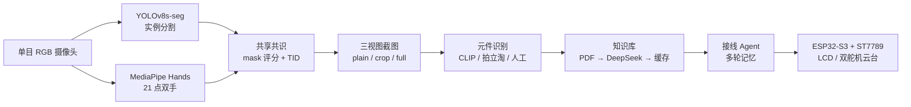

# Shared Consensus：桌面电子元件多模态识别与交互系统

> 用单目 RGB 摄像头锁定你正在指/拿的元件，识别型号，查引脚/接线，并在 ESP32 屏幕上显示。
>
> A monocular RGB desktop assistant that locks onto the component you point at, recognizes its model, retrieves pinout/wiring knowledge, and displays the result on an ESP32 terminal.

<p>
  <b>关键词：</b>YOLOv8-seg · MediaPipe · 时序共识 · OpenCLIP · 视觉搜索 · DeepSeek · ESP32-S3
</p>

> 🎬 演示视频：
> [识别模式](https://github.com/yanzhihan22-debug/shared-consensus-assistant/releases/download/v1.0-demo/recognition.mp4) ·
> [接线模式](https://github.com/yanzhihan22-debug/shared-consensus-assistant/releases/download/v1.0-demo/wiring.mp4) ·
> [淘宝链接](https://github.com/yanzhihan22-debug/shared-consensus-assistant/releases/download/v1.0-demo/taobao.mp4)

## 1. 这个项目解决什么问题

在实验室、电子制作或展台场景，桌面上经常同时摆着多种开发板、舵机、屏幕和线材。用户会用手指或拿起某个元件问：

- “这个是什么型号？”
- “这个元件怎么接线？”
- “到哪里买？”

传统方案要么只做物体检测，要么把手势和物体识别分开跑，容易出现三个问题：

1. **指代模糊**：桌面上多个物体，机器人不知道用户到底指哪个；
2. **目标跳变**：手一抖、光一变，识别目标在多个物体之间反复跳；
3. **识别/知识脱节**：认出“这是一个模块”容易，但给出可核对的型号、引脚和接线建议难。

本项目把链路串成闭环：

**目标共识 → 型号识别 → 知识检索 → 接线建议 → 屏幕/云台反馈**

---

## 2. 效果

| 模块 | 结果 |
|---|---|
| 目标共识 | 8 帧/5 票 + 30 帧记忆 + 3/5 帧迟滞 + 120 px 解锁；YOLOv8s-seg 每 2 帧；遮挡约 1 s 不丢目标（设计值） |
| 元件识别 | 22 张/6 类真实拍摄回归集（评测集不随仓库分发，报告见 `docs/taobao_batch_report.json`）：top-1 **72.7% → 86.4%**（+13.6 pp，错误数 6→3） |
| 类别消歧 | 加“类别→库内唯一型号”规则可到 **90.9%**（20/22，下一步，未默认启用） |
| 知识库 | 15 个元件、最多 31 pin；28 份 PDF（本地数据，不随仓库分发）→ DeepSeek JSON → 本地缓存；首次约 3 s、缓存约 0 s |
| 终端 | ESP32-S3 + ST7789 240×240；串口 + WiFi UDP；双舵机云台；讯飞语音 + 键盘兜底 |

**误差分层（重要）**：6 个错误 = 标签空间 4 例（面包板×3、舵机×1）+ 同色 PCB 2 例（MAX98357A→ESP32-S3-CAM）。前者靠归一化，后者靠 CLIP 复核/拒识；目前仍有 2 例同色 PCB 混淆，已在 README 的“已知限制”中说明。

> 说明：86.4% 是按 22 张原始输出做确定性复算；90.9% 需要额外规则，不当作已达成。

---

## 3. 系统结构



### 3.1 前端共识

- **物体流**：YOLOv8s-seg 输出像素 mask，过滤 person/table/chair 等；
- **手部流**：MediaPipe Hands 输出双手 21 点；按手指伸展数识别 `POINTING / HOLDING / OPEN_PALM`；
- **锚点**：食指尖 → 中指根 → 手腕（EMA 0.65/0.35）；
- **评分**：指尖必须落框 + 手部凸包 mask 像素落入目标区域的比例（0.5–1.0），替代 bbox IoU；
- **时序**：8 帧滑窗 ≥5 票、30 帧记忆、3 帧锁定、5 帧切换、120 px 解锁；
- **消歧**：实例级 TID 区分同标签多物体；双手冲突进入“抖动选择”；
- **兜底**：MediaPipe 丢手时用 YOLO person mask 形态学提手臂。

### 3.2 后端识别

- **本地快速通道**：OpenCLIP ViT-B-32 / LAION-2B，余弦相似度，类内 max；0.75 高分直判，或 0.62 + top1-top2 gap 0.05 判可信；
- **零样本召回**：Playwright 驱动淘宝拍立淘，注入图片、抓标题、候选/型号投票；
- **开放词表清洗**：候选词长优先 + “字母+数字+后缀”型号正则 + 噪声词过滤 + 型号票≥2 优先；
- **归一化**：`norm` + 中英映射（面包板→BREADBOARD、舵机→SERVO…）+ 别名/系列映射（ESP32→ESP32-S3-CAM）；
- **兜底**：低置信转人工确认；Qwen-VL 为早期对照方案。

### 3.3 知识库与接线 Agent

- 28 份 PDF → PyMuPDF 取前 3000 字符 → DeepSeek JSON（name/voltage/pins/usage/source）→ 本地缓存；
- 无 PDF 走通用知识兜底；`components_db.json` 保存 15 个元件、最多 31 pin；
- DeepSeek Agent 多轮记忆已识别元件与引脚；说“接线”生成逐行建议；新元件自动追加/重算；
- 结果带 `source`，方便人工核对；LCD 只输出 ASCII、19 字符/行。

---

## 4. 硬件

| 部件 | 说明 |
|---|---|
| 主控 | PC（Windows/Linux，Python 3.10+） |
| 摄像头 | USB 摄像头，1280×720 MJPG@30 最佳 |
| 终端 | ESP32-S3 + ST7789 240×240 SPI LCD |
| 云台 | 双舵机（S1 上下 / S2 左右），50 Hz PWM |
| 语音 | PC 麦克风 + 讯飞听写（可选） |
| 其他 | 面包板/PCB、5V 供电、3D 打印外壳（可选） |

> 没有硬件也能跑前端/后端识别；串口/UDP 不可用时程序会自动降级。

---

## 5. 快速开始

### 5.1 环境

```bash
git clone https://github.com/yanzhihan22-debug/shared-consensus-assistant.git
cd shared-consensus-assistant

python -m venv .venv
# Windows
.venv\Scripts\activate
# macOS / Linux
# source .venv/bin/activate

pip install -r requirements.txt
playwright install chromium
```

> `mediapipe` 对 Python 3.12 的支持可能不稳定；建议 3.10/3.11。`pyaudio` 安装失败时可以先注释掉，语音功能不影响主线。

### 5.2 模型权重

`yolov8s-seg.pt` 不提交到仓库，首次运行前下载到项目根目录：

```bash
python -c "from ultralytics import YOLO; YOLO('yolov8s-seg.pt')"
```

### 5.3 配置

复制 `.env.example` 为 `.env`，填入自己的 Key（**不要把 `.env` 提交到 GitHub**）：

```bash
cp .env.example .env
```

| 变量 | 用途 | 必填 |
|---|---|---|
| `DEEPSEEK_API_KEY` | DeepSeek 接线/知识抽取 | 是（知识库） |
| `DASHSCOPE_API_KEY` | Qwen-VL 早期对照方案 | 否 |
| `XF_APPID` / `XF_API_SECRET` / `XF_API_KEY` | 讯飞语音听写 | 否（语音） |
| `SERIAL_PORT` | ESP32 串口，如 `COM4` | 否（默认 COM4） |
| `ESP32_IP` | ESP32 UDP 地址 | 否（默认 192.168.1.200） |

也可以直接用环境变量（PowerShell）：

```powershell
$env:DEEPSEEK_API_KEY="sk-..."
$env:SERIAL_PORT="COM4"
$env:ESP32_IP="192.168.1.200"
python main.py
```

### 5.4 运行

```bash
python main.py
```

常用按键：

| 键 | 功能 |
|---|---|
| `Space` | 冻结当前目标 / 再次按退出冻结 |
| `i` | 识别当前截图 |
| `w` | 接线模式：显示/刷新接线建议 |
| `m` | 开启接线模式（清空旧元件） |
| `c` | 完全重置 |
| `t` | 开关云台跟踪 |
| `q` | 退出 |

首次使用淘宝识图前，先登录并保存会话（只保存在本地，不提交）：

```bash
python taobao_login.py
```

### 5.5 ESP32 固件

**Arduino / LovyanGFX（推荐先跑这个）**

- 文件：`firmware/led_track/led_track.ino`
- 依赖：Arduino IDE + ESP32 板卡包 + LovyanGFX
- 修改文件顶部的 `YOUR_WIFI_SSID` / `YOUR_WIFI_PASSWORD`，以及 `ESP32_IP`
- 上传后，LCD 会显示 PC 发来的文本；串口/UDP 协议见下

**ESP-IDF（可选）**

- 目录：`firmware/esp32-lcd/`
- `idf.py build flash monitor`
- `sdkconfig` 是本地生成文件，不提交；从 `sdkconfig.defaults` 开始

**协议**：换行结尾 ASCII 文本；`s1:xx s2:xx` 为舵机角度；其余文本显示到 LCD。串口 115200，UDP 8888。

---

## 6. 目录结构

```
.
├─ main.py                 # 主程序：摄像头、共识、识别、串口/UDP
├─ component_kb.py         # PDF → DeepSeek → 本地缓存
├─ matcher.py              # OpenCLIP 本地库
├─ taobao_search.py        # 拍立淘视觉搜索
├─ taobao_login.py         # 保存淘宝登录态（本地）
├─ voice_control.py        # 讯飞语音听写 + VAD + 命令队列
├─ build_db.py             # 手动建库工具
├─ MANUAL_DB.json          # 元件库（型号/引脚/照片路径）
├─ components_db.json      # 知识库缓存（15 元件）
├─ firmware/
│  ├─ led_track/           # Arduino + LovyanGFX
│  └─ esp32-lcd/           # ESP-IDF + esp_lcd
├─ docs/
│  ├─ media.md             # 演示视频说明
│  └─ taobao_batch_report.json
├─ ref_images/             # 自己的参考照片（不提交）
├─ datasheets/             # 可选 PDF 数据手册（不提交）
├─ requirements.txt
├─ .env.example
└─ .gitignore
```

---

## 7. 数据与评测

### 7.1 元件库

- `MANUAL_DB.json`：`key -> {name, pins, photos}`；照片路径相对项目根目录；
- 添加照片：在 `ref_images/<型号>/` 放 1–3 张，运行 `python build_db.py` 的“同步照片”，或手动改 JSON；
- `matcher.py` 首次会建立 CLIP 索引；没有照片时索引为空，不影响拍立淘路径。

### 7.2 数据手册

- 可选：把 PDF 放到 `datasheets/`，`component_kb.py` 会按文件名匹配；
- 没有 PDF 时走 DeepSeek 通用知识兜底，并在结果里标注来源；
- `components_db.json` 已包含 15 个常用元件的缓存，可直接用。

### 7.3 回归集

`test_taobao_batch.py` 对 22 张/6 类图片跑淘宝识图，输出 `taobao_batch_report.json`。当前仓库保留了这次评测的报告：

- 原始 top-1：16/22（72.7%）
- 中英/别名归一化后：19/22（86.4%）
- 类别→型号消歧：20/22（90.9%，下一步）

评测口径与误差分析见 `docs/taobao_batch_report.json` 和项目报告。

---

## 8. 已知限制

1. **同色 PCB 混淆**：2 例 MAX98357A 被识别为 ESP32-S3-CAM；当前保留为已知失败样本，下一步用 CLIP top-2 复核/拒识。
2. **淘宝依赖**：拍立淘受平台策略/限流影响；脚本只做低频研究用途，请遵守平台条款。
3. **前端没有标注集**：8/30/3-5 帧是设计参数；没有写“前端准确率 95%”这类数字。
4. **首次识别约 3 s**：0 s 指缓存命中，不是首次。
5. **模型权重不提交**：`yolov8s-seg.pt`、CLIP 权重需自行下载。
6. **语音是可选链路**：讯飞 Key/网络不可用时，键盘仍然可用。

---

## 9. 安全与隐私

- **不要提交** `.env`、`taobao_state.json`、`ref_images/`、`consensus_crops/`、个人 PDF/视频；
- `taobao_state.json` 含登录 Cookie，只放本地；
- 如果你曾在代码/聊天里暴露过 API Key，请立刻到对应平台**吊销并重新生成**；
- 淘宝识图仅用于个人学习/研究，请控制频率，遵守平台条款。

---

## 10. License

MIT License，见 [LICENSE](LICENSE)。

---

## 11. Acknowledgements

- [Ultralytics YOLOv8](https://github.com/ultralytics/ultralytics)
- [MediaPipe](https://github.com/google-ai-edge/mediapipe)
- [OpenCLIP](https://github.com/mlfoundations/open_clip)
- [Playwright](https://github.com/microsoft/playwright)
- [PyMuPDF](https://github.com/pymupdf/PyMuPDF)
- [DeepSeek](https://www.deepseek.com/) / [DashScope](https://dashscope.aliyun.com/)
- [讯飞开放平台](https://www.xfyun.cn/)
- [LovyanGFX](https://github.com/lovyan03/LovyanGFX)
- ESP-IDF / esp_lcd

---

## 12. 项目背景

浙江大学湖州研究院 · 海洋机器人实习（2026.06–2026.08）。  
从“共享共识”目标锁定出发，逐步扩展到元件识别、知识检索、接线 Agent 和 ESP32 终端。

如果这个项目对你有帮助，欢迎 Star ⭐ 或提 Issue。
